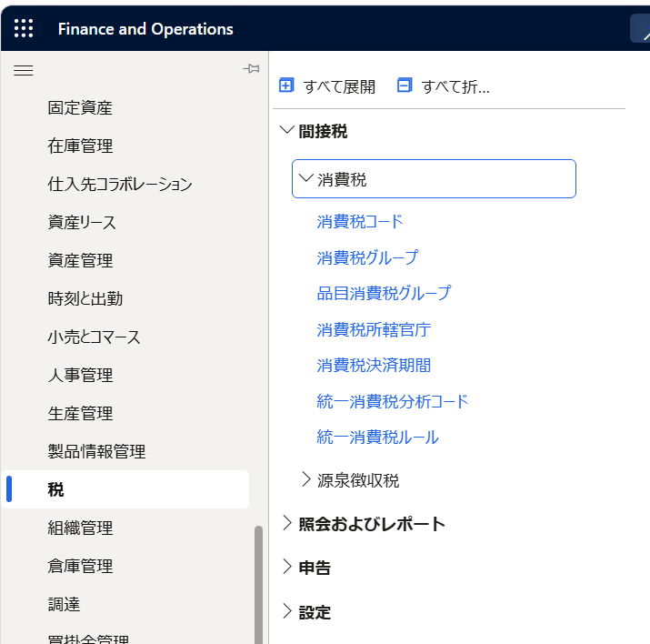
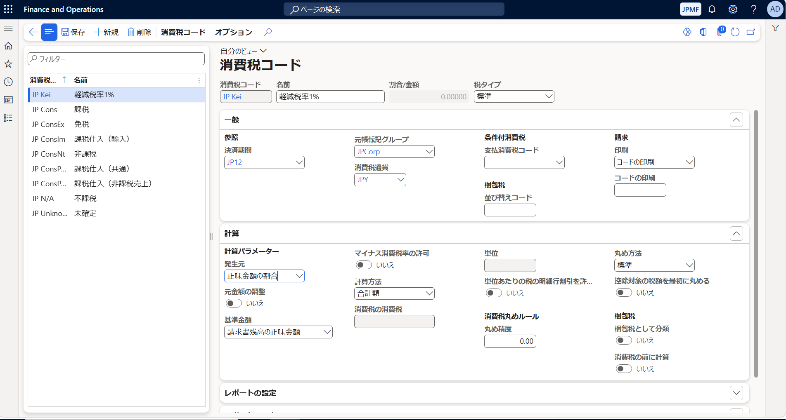
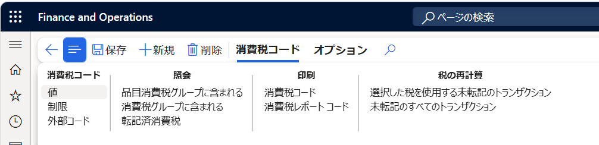
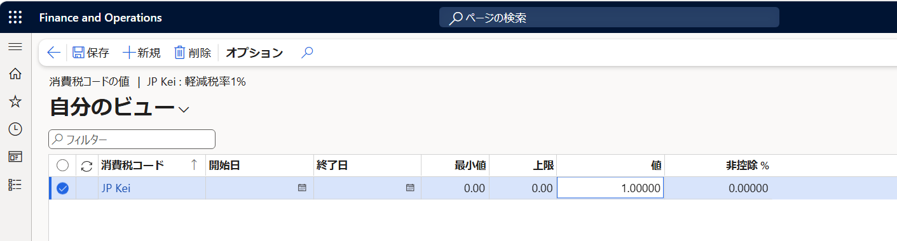

こんにちは、日本マイクロソフト Dynamics ERP サポート チームの尾崎です。

この記事では、飲食料品に係る消費税率の引下げに向けて、Dynamics 365 Finance で新しい税率用の消費税コードを追加する方法と、変更に向けた進め方のイメージをご紹介します。

制度の詳細および最新情報については、国税庁の公開情報をご確認ください。

[国税庁 消費税率引下げ特設サイト](https://www.nta.go.jp/taxes/shiraberu/zeimokubetsu/shohi/keigenzeiritsu/zeiritsuhikisage.htm)

<!-- more -->

## 本記事の前提

本記事は、2026 年 10 月 28 日時点で確認した公開情報に基づいています。

国税庁の特設サイトには、2026 年 9 月 15 日に閣議決定された大綱に示された改正案の説明資料が掲載されています。同サイトでは、掲載内容は、関連法案が国会で審議され、可決・成立した場合のものであると案内されています。

本記事は、この案内を踏まえ、事前準備のポイントを整理したものです。法改正の成立状況や制度の最終的な取扱いを本記事のみで判断せず、準備時および適用前に最新の公式情報をご確認ください。

## 検証に用いた製品・バージョン

| 項目 | 値 |
| --- | --- |
| 製品 | Dynamics 365 Finance and Operations |
| Application version | 10.0.48 |
| Platform version | PU 72 |
| Legal entity | JPMF |

## 消費税コードの追加に当たっての考慮事項

Microsoft Learn「日本の適格請求書システム」の「Considerations」には、次のように記載されています。

> 請求書と連結請求書の税金を正確に計算、丸め、印刷するには、税率ごとに 1 つの売上税コードのみを使用します。

出典：[Microsoft Learn 日本の適格請求書システム — Considerations](https://learn.microsoft.com/ja-jp/dynamics365/finance/localizations/japan/apac-jpn-qualified-invoice-system#considerations)

この考慮事項に沿って、本稿では、既存の 8% 用コードの税率や適用期間を変更するのではなく、新たに 1% 用の消費税コードを作成する設定例をご紹介します。

## 消費税コードの追加方法

以下は、Microsoft Learn「消費税コードを設定します」に記載された作成手順に沿って、税率を 1% とする例です。

1. **[税] > [間接税] > [消費税] > [消費税コード]** の順に選択します。

   

2. **[新規]** を選択し、消費税コードと名前を入力します。続いて、決済期間、元帳転記グループ、および **[計算]** の各項目を設定します。日本向けの設定については、Microsoft Learn「日本の適格請求書システム」の「JCT の消費税を設定します」をご参照ください。

   

3. アクション ウィンドウで、**[消費税コード] > [値]** の順に選択します。

   

4. **[値]** に `1` を入力します。これは、課税対象額に対する割合で税額を計算するコードの例です。

   

5. **[保存]** を選択した後、画面を閉じて消費税コードを保存します。

出典
[Microsoft Learn 消費税コードを設定します](https://learn.microsoft.com/ja-jp/dynamics365/finance/general-ledger/tasks/set-up-sales-tax-codes)
[Microsoft Learn JCT の消費税を設定します](https://learn.microsoft.com/ja-jp/dynamics365/finance/localizations/japan/apac-jpn-qualified-invoice-system#set-up-sales-tax-for-jct)

## 変更に向けた進め方のイメージ

取引に適用される消費税コードは、その取引の消費税グループと品目消費税グループの両方に含まれるコードによって決まります。新しいコードの作成に加え、対象の取引に適用するためのグループの設定が必要です。

出典：[Microsoft Learn 売上税グループと品目売上税グループの設定](https://learn.microsoft.com/ja-jp/dynamics365/finance/general-ledger/tasks/set-up-sales-tax-groups-item-sales-tax-groups)

この仕組みを踏まえ、準備の進め方の例を示します。

1. 変更対象を確認する  
   最新の制度情報を確認し、対象の取引で使用している消費税コードを整理します。
2. テスト環境で 1% 用コードを作成する  
   既存の 8% 用コードとは別に、新しい消費税コードを作成します。
3. 対象取引に適用する設定を準備する  
   適用する税率に応じたコードが使用されるよう、消費税グループと品目消費税グループの設定を準備します。同じ請求書内で同じ税率のコードを複数使用しないようにします。
4. 動作を確認し、本番環境へ反映する  
   テスト環境での確認後、本番環境への設定反映を進めます。

アドオンや帳票、外部連携などの構成はお客様ごとに異なります。これらへの影響も含め、普段ご利用の業務が想定どおり動作することを、事前にテスト環境でご確認ください。

## おわりに

以上、Dynamics 365 Finance で新しい税率用の消費税コードを追加する方法と、変更に向けた進め方のイメージをご紹介しました。
制度の最新情報をご確認のうえ、ご利用の環境に合わせて準備を進めていただけますと幸いです。